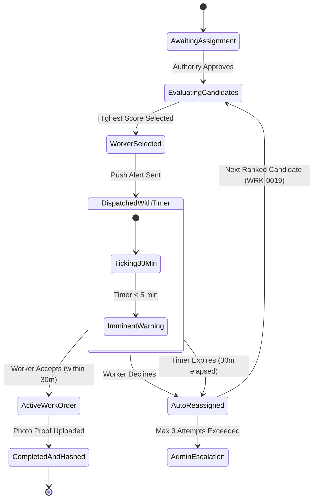

# CampusFlow — Intelligent Worker Dispatch Algorithm

## 1. Candidate Fitness Scoring Formula

Upon HOD or Warden verification of a maintenance request $C$, the Autonomous Dispatch Engine evaluates all online technicians $W_i$ within the target department.

The fitness score $S(W_i)$ is determined by the multi-criteria weighted sum:

$$S(W_i) = \left(w_{\text{dept}} \cdot T_i\right) + \left(w_{\text{skill}} \cdot K_i\right) + \left(w_{\text{prox}} \cdot P_i\right) + \left(w_{\text{fair}} \cdot F_i\right)$$

Where:
- **$T_i \in \{0, 1\}$**: Trade Compatibility. Must be $1.0$; if $0.0$, $S(W_i) = 0$ (hard filter).
- **$K_i \in [0, 1]$**: Skill Certification Overlap:
  $$K_i = \frac{|\text{Skills}(W_i) \cap \text{RequiredSkills}(C)|}{|\text{RequiredSkills}(C)|}$$
- **$P_i \in [0, 1]$**: Proximity to Target Geofenced Location:
  - $1.0$: Technician currently operating in the same building/zone.
  - $0.8$: Technician in an adjacent building zone.
  - $0.6$: Technician elsewhere on campus.
- **$F_i \in (0, 1]$**: Workload Fairness (Anti-Fatigue):
  $$F_i = \frac{1}{1 + \text{ActiveJobs}(W_i)}$$

---

## 2. Default Configurable Algorithm Weights
- $w_{\text{dept}} = 0.35$ (35%)
- $w_{\text{skill}} = 0.25$ (25%)
- $w_{\text{prox}} = 0.20$ (20%)
- $w_{\text{fair}} = 0.20$ (20%)
- **Sum**: $\sum w = 1.00$

Weights can be hot-reloaded without server restarts via the **Super Admin Governance Console** (`#super-assignment-engine`).

---

## 3. 30-Minute SLA Timer & Reassignment Cascade State Machine

